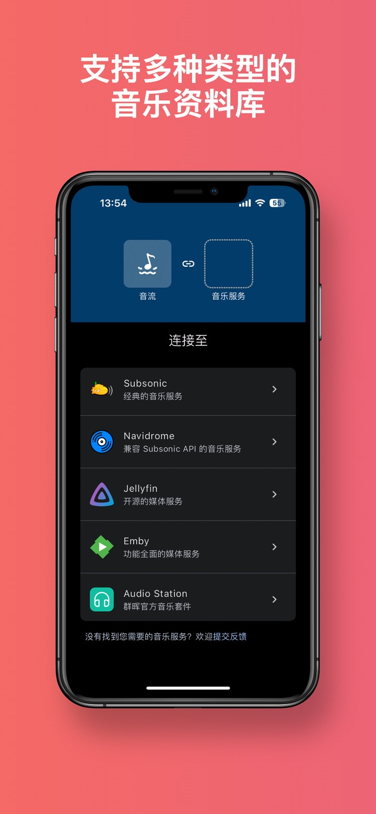
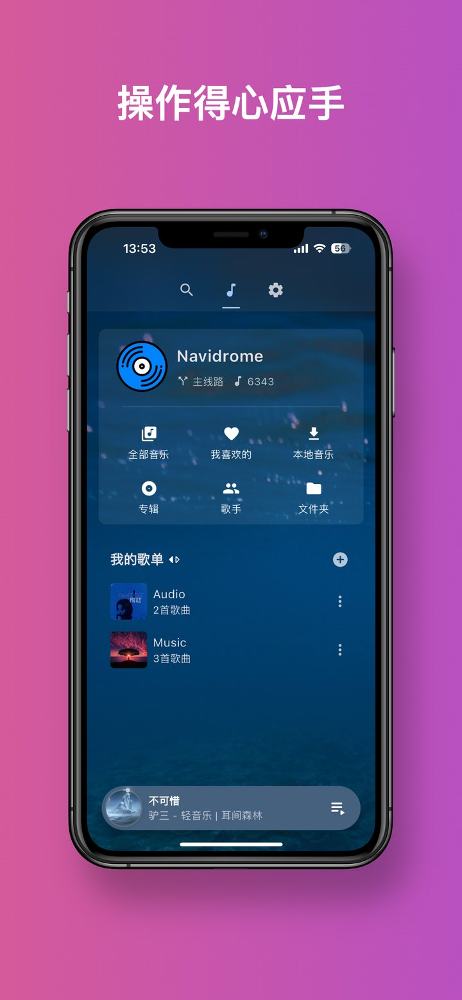
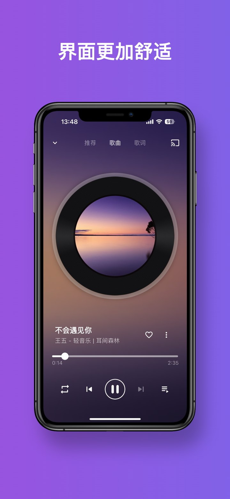
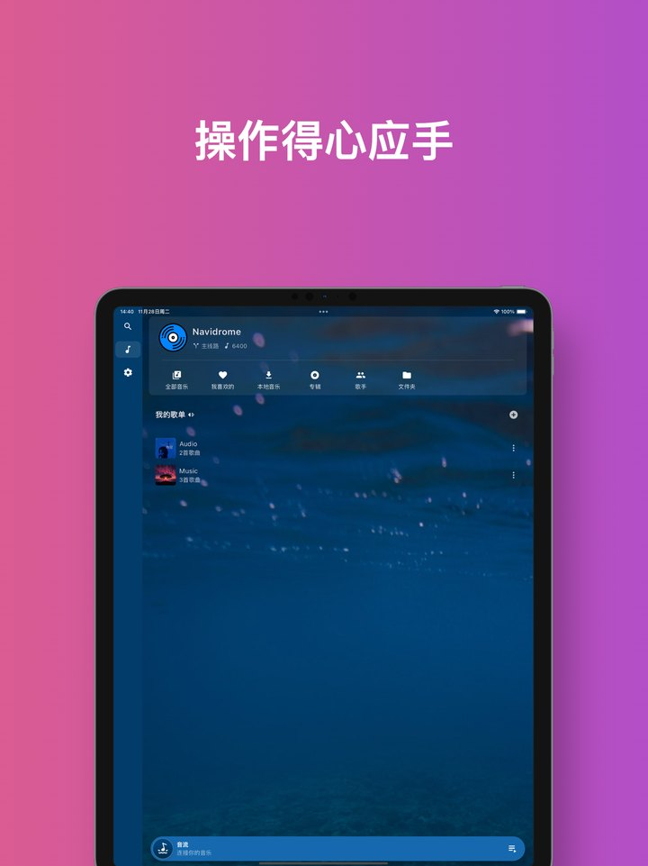

# 02 · 音流 / Musiver 1.3.9

> **本文只覆盖 1.3.9（Flutter 版）。** 音流 2.0 是彻底重写（Rust 核心 + Kotlin/Compose 原生客户端，
> 包名改为 `cn.musiver.android`），界面结构与实现方式都与本文不同。2.0 全屏播放页的实测数据见
> [../gemini-brief-musiver.txt](../gemini-brief-musiver.txt)。

> 同类产品参考。自建音乐库客户端（Subsonic / Navidrome / Jellyfin / Emby / AudioStation / Plex），
> 跨 Android / iOS / macOS / Windows。**非开源**，仓库只放文档站与发布产物。

## 1. 包事实（APK）

| 项 | 值 |
| --- | --- |
| 包名 / 应用名 | `cn.aqzscn.stream_music` / Musiver |
| 版本 | 1.3.9（versionCode 135） |
| minSdk / targetSdk | 23 / 35 |
| 技术栈 | Flutter（`lib/arm64-v8a/libapp.so` 12.1 MB）+ `libmpv.so`（media_kit 播放内核）+ `librust_lib_stream_music.so`（Rust 业务层）+ `librhttp.so` |
| 条目 | 1938（res 1689 / assets 85 / lib 13） |
| 自带字体 | **27 个，全部是图标字体**：MaterialIcons、CupertinoIcons、FluentIcons、FluentSystemIcons(Regular/Filled)、FontAwesome(4/5)、MaterialDesignIcons、fluttericon 全家族 —— **没有一套正文字体** |
| 内置图片 | `background.png` 605×907（水下摄影）、`album_bg.png` 1280×1142、`album_disc.png` 784×784（黑胶唱片框）、`artist_background.jpg` 1280×853、`favorite/download/suggestion_background.jpg` 640×4xx、9 张 TV 端装饰图 |
| ARSC | color 224 / dimen 309 / string 134 —— 数值上几乎全是 AndroidX 与 Play Core 的资源，**它自己的设计体系不在 ARSC 里** |

结论：**这是一个"资源极简 + 代码内主题"的 Flutter 应用**。它的视觉几乎全部由
「1 张照片背景 + 1 个黑胶框 + 主题色 + 模糊 + 半透明」组合出来，而不是靠一套组件库。

## 2. 从 `libapp.so` 字符串能读到的设计意图（APK）

字符串表里与主题相关的条目（原样摘录）：

```
settings/theme            /settings/theme/custom_background      /settings/theme/lyric
themeType  themeLightDark  lightTheme  darkTheme  systemTheme  defaultTheme
blur  blurOff  blurBackground  blurLinear  blurRadial
gradientVertical  gradientHorizontal  gradientRadial
radius  radiusOutline  corners  opacity
"Default Material You theme at 2021 launch."
```

可以确认三件事（**APK**）：

1. **主题是一等公民**：明/暗/跟随系统 + 自定义背景图 + 歌词主题，各自独立设置页。
2. **模糊是可配置项**：`blurBackground` / `blurLinear` / `blurRadial` 三种模糊形态，
   说明"封面模糊铺底"是它刻意做的产品能力，不是顺手加的。
3. **动态取色**：`Default Material You theme` 明示使用 Material You（Android 12+ 壁纸取色），
   这也解释了为什么它的主色在不同截图里不一致。

## 3. 逐屏观察（截图）

### 3.1 连接服务器页



- 顶部是"音流 ⇄ 音乐服务"的双卡片示意（左边实心圆角方块图标，右边虚线空框），**用图形讲协议**。
- 下方是 5 个服务商的列表：每行 = 品牌图标（彩色、带圆角）+ 主标题 + 灰色副标题 + 右箭头。
- 行高约 56–60dp，行与行之间用**极细的分隔线 + 卡片分组**，不是纯列表。
- 底部一句灰色小字"没有找到您需要的音乐服务？欢迎提交反馈" —— 空态兜底写成了常驻提示。

### 3.2 音乐库首页



- **背景**：整屏一张深蓝水下摄影图，上暗下亮，全屏铺满。
- **顶部栏**：只有三个图标（搜索 / 正在播放 / 设置），中间用一条短下划线标出当前页 ——
  这是 Flutter 常见的极简 tab，**没有文字标签**，靠图标语义。
- **服务器卡片**：半透明白（约 6–8%）+ 模糊，圆角约 12–16dp；左侧服务器图标、标题、副标题
  "主线路 · ♫ 6343"（图标 + 数字混排）。
- **六宫格**：全部音乐 / 我喜欢的 / 本地音乐 / 专辑 / 歌手 / 文件夹 —— 线性图标 + 11–12sp 文字，
  图标在上文字在下，格子无边框，靠间距分组。
- **我的歌单**：区块标题 + 右侧"+"，列表项 = 40dp 封面缩略图 + 标题 + "2首歌曲" + 三点菜单。
- **底部 mini player**：一条圆角胶囊（约 16dp 圆角、半透明），内含 32dp 圆形封面、标题、
  "艺人 · 轻音乐 | 耳间森林"、右侧播放列表按钮。**它悬浮在安全区之上，不与 tab 栏合并。**

### 3.3 播放器（核心屏）



这是全篇最值得看的一屏：

- **背景**：封面图的超强模糊 + 垂直渐变遮罩（上深下浅），整屏无纯色区域。
- **顶部分段 tab**：`推荐 / 歌曲 / 歌词`，居中，当前项白色 + 下方 2px 短横线；左侧返回 chevron、
  右侧投屏图标。**三段式把"播放器 / 队列 / 歌词"塞进同一屏**，不做多层导航。
- **黑胶**：圆形封面（直径约屏宽 62%）外套一圈黑色唱片纹 `album_disc.png`，
  唱片边缘有高光。**这是它的视觉签名**，也是最容易被记住的一点。
- **信息区**：左对齐标题（约 20sp 半粗）+ 副标题"王五 · 轻音乐 | 耳间森林"（约 12–13sp，60% 白），
  右侧心形 + 三点菜单。
- **进度条**：2px 轨道，白色圆点 thumb（约 12dp），两端时间 11sp 灰色，**没有拖拽放大态**（未验证）。
- **控制区**：循环 / 上一首 / 圆形描边播放键（直径约 56–60dp，1.5px 描边）/ 下一首 / 队列。
  **播放键不用实心品牌色，用描边圆**——这是它和 Spotify/Apple 最直观的差别。

### 3.4 平板



- 左侧一条**竖向图标 rail**（搜索 / 歌单 / 设置），内容区右移，顶部仍是服务器卡片 + 六宫格。
- mini player 变成通栏长条，仍在底部。
- 结论（**推断**）：它做的是"同一套组件 + 断点换导航形态"，没有为平板重排信息架构。

## 4. 设计语言提炼

| 维度 | 做法 | 评价 |
| --- | --- | --- |
| 色彩策略 | 没有品牌主色；主色来自 Material You 壁纸取色 / 封面取色 | 有氛围，但**品牌识别为零**，截图之间自己都不统一 |
| 明暗 | 深色优先（截图全部深色），但设置里有明/暗/跟随 | 合理 |
| 背景 | 全局照片 + 封面模糊 + 渐变遮罩 | 差异化最强的一点，也是性能与可读性的风险点 |
| 材质 | 半透明白卡片 + 模糊（玻璃拟态） | 在深色照片上效果好；浅色模式下需要另一套参数（未验证） |
| 形状 | 卡片 12–16dp、mini player 胶囊、播放键圆形描边 | 偏 Material 3，圆角比 Spotify 大 |
| 图标 | Material + Cupertino + Fluent + FontAwesome + MDI 混用 | **明显短板**：同一屏里笔画粗细与圆角风格不一致 |
| 字体 | 零正文字体，全靠系统 | 中文没问题（系统字体质量高），但数字（时长/进度）不等宽，会跳字 |
| 密度 | 列表行 56–60dp，六宫格宽松 | 比 Spotify 松，比 Apple 紧 |
| 导航 | 手机：底部 mini player + 顶部图标 tab；平板：左侧 rail | 手机端**没有常规底部 tab bar**，一级入口靠首页六宫格 |

## 5. 可以借鉴 / 应当避开

**借鉴**

1. **黑胶唱片隐喻**：一个 784×784 的 PNG + 圆形裁切封面就能做出强记忆点，成本极低。
2. **播放器三段式 tab（推荐/歌曲/歌词）**：把三个高频页面压进一屏，减少导航层级，
   很适合"纯消费"定位（用户不管理库，只想听）。
3. **mini player 独立悬浮**：与 tab bar 解耦，未来加 tab 不影响播放器。
4. **连接页用图形讲协议**（音流 ⇄ 服务），比纯文字列表更容易理解"这是个客户端"。
5. **模糊强度可配置**：把"氛围"做成开关，而不是强制。

**避开**

1. **五套图标字体混用** —— 一屏之内风格不统一，是"看起来不像产品"的主因。
2. **零正文字体 + 非等宽数字** —— 进度与时长会横向抖动。
3. **照片背景不设对比度下限** —— 深色照片上白字尚可，换成浅色自定义背景就会崩。
4. **无品牌色** —— 全屏取色很漂亮，但用户截十张图，十张颜色都不一样，缺少识别锚点。

## 6. 未解之谜（未知）

- 模糊的具体半径与遮罩透明度：Flutter 的 `BackdropFilter` 参数编译进 AOT，无法静态读出。
- 黑胶是否真的匀速旋转、转速多少（截图是静帧）。
- 歌词页排版（截图里被"推荐"页挡住）。
- 是否支持平板双栏（截图只有 rail + 单栏）。
