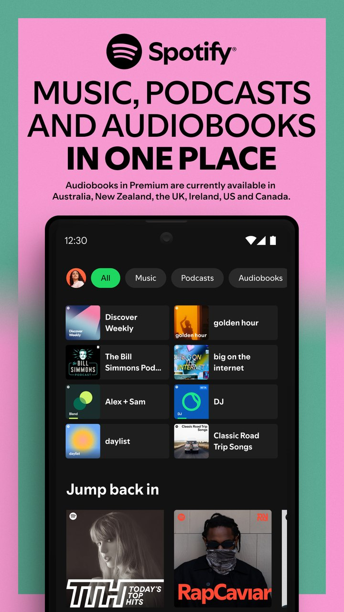
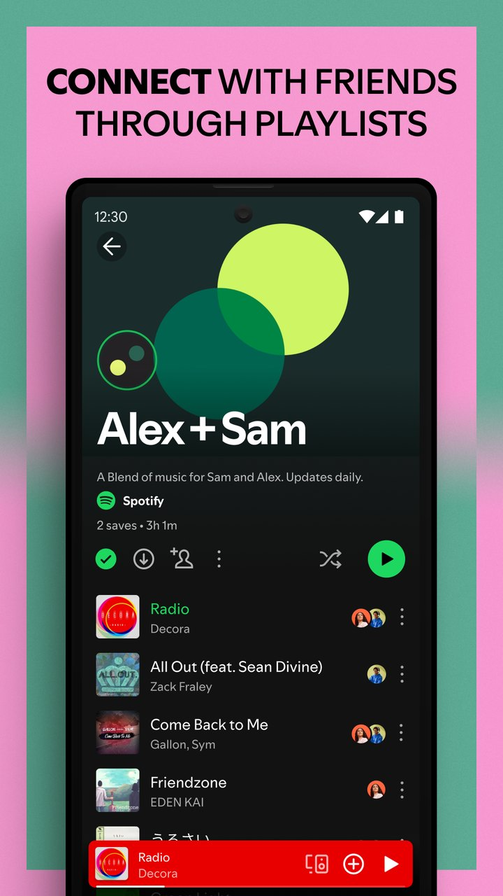
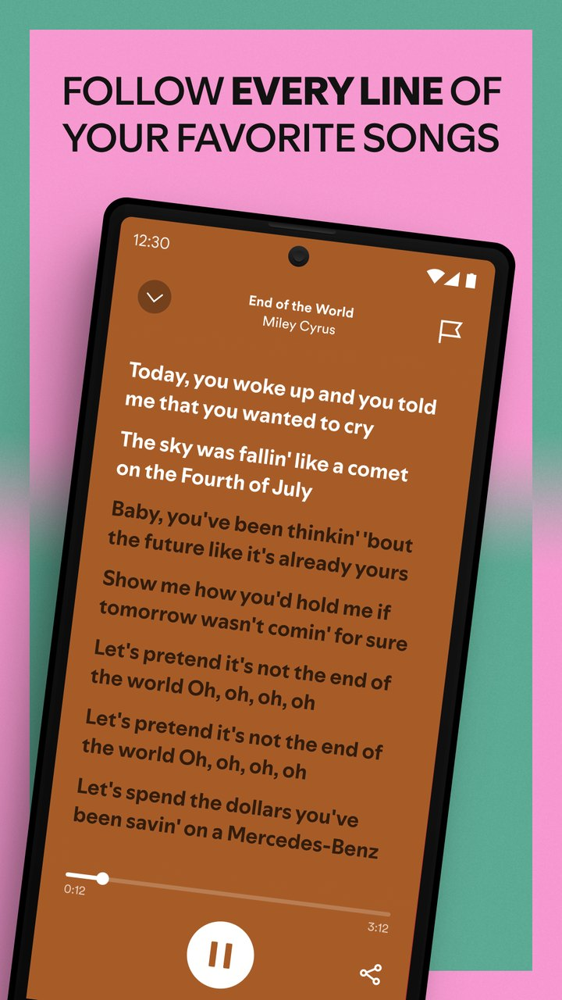
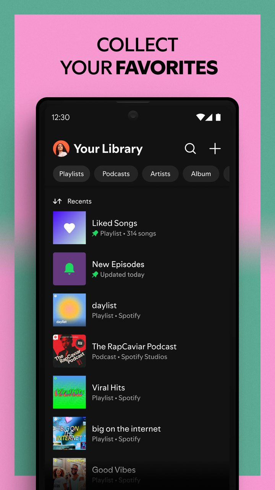

# 03 · Spotify 9.2.0

> 移动端音乐播放器的交互事实标准。本文重点是它**写进 APK 的设计系统（Encore）**，
> 这是三家里唯一能拿到完整数值阶梯的样本。

## 1. 包事实（APK）

| 项 | 值 |
| --- | --- |
| 包名 | `com.spotify.music` |
| 版本 | 9.2.0.2053（versionCode 148387875） |
| minSdk / targetSdk | 24 / 37 |
| base APK 条目 | 4092 |
| 图标 | **1542 个 drawable XML vs 31 个位图** → 图标近乎全矢量 |
| 字体（`res/font/`） | `spotify_mix_ui_regular/bold.otf`、按书写系统分包的 Mix UI（arab / cyrl / grek / hebr）、`spotify_mix_mono_regular.otf`、`spoticon.ttf`（图标字体） |
| 颜色 | 1176 条，**全部是动态引用**（解析值形如 `#000000ce`），真实色值在代码里 |
| 尺寸 | 1538 条，其中 `encore_*` 命名空间 126 条可解析为数值 |

**关键判断（APK）**：Spotify 有一套正式命名的设计系统 `encore`，而且它把
**间距 / 字号 / 圆角 / 控件尺寸**四类 token 全部写进了资源表。这在消费级 App 里很少见，
说明它的 UI 是"按 token 拼"的，不是"按页面画"的。

## 2. Encore token 全表（APK，单位 dip/sp）

### 2.1 间距阶梯

| token | 值 |
| --- | --- |
| `encore_spacer_tighter_5` | 2 |
| `encore_spacer_tighter_4` | 4 |
| `encore_spacer_tighter_3` | 6 |
| `encore_spacer_tighter_2` | 8 |
| `encore_spacer_tighter` | 12 |
| `encore_spacer_base` | **16** |
| `encore_spacer_looser` | 20 |
| `encore_spacer_looser_2` | 24 |
| `encore_spacer_looser_3` | 32 |
| `encore_spacer_looser_4` | 40 |
| `encore_spacer_looser_5` | 48 |
| `encore_spacer_looser_6` | 64 |

另有 `encore_layout_margin_base = 16`、`encore_layout_max_width_narrow = 640`
（窄屏/平板的内容最大宽度约束）。

**读法**：这是一条 4 基数的阶梯，但**刻意跳过了 10 和 14**，且 2/6 两个"半档"用于图标内边距。
好处是视觉节奏稳定，坏处是档位偏少，做密集列表时容易不够用（他们会用 4 和 8 顶替）。

### 2.2 字号阶梯

| token | 值 | 典型用途（推断） |
| --- | --- | --- |
| `encore_text_size_smaller_3` | 9 | 角标、极次要信息 |
| `encore_text_size_smaller_2` | 11 | 时间戳、副标题 |
| `encore_text_size_smaller` | 13 | 列表副标题 |
| `encore_text_size_base` | **16** | 正文、列表主标题 |
| `encore_text_size_larger` | 20 | 区块小标题 |
| `encore_text_size_larger_2` | 24 | 区块标题 |
| `encore_text_size_larger_3` | 32 | 页面标题 |
| `encore_text_size_larger_4` | 40 | 大标题 |
| `encore_text_size_larger_5` | 48 | 歌单/专辑页 display 标题 |

对比：Android 默认 type scale 是 12/14/16/20/24/34，Spotify 的**下限更低（9/11）、上限更高（48）**，
中间档更密（13/16/20/24/32）。这带来的是更强的层级对比：列表很密，标题很大。

### 2.3 圆角阶梯

| token | 值 | 用途 |
| --- | --- | --- |
| `encore_corner_radius_smaller` | 2 | 徽标 |
| `encore_corner_radius_base` | **4** | 按钮、输入框 |
| `encore_corner_radius_larger` | 6 | 卡片内元素 |
| `encore_corner_radius_larger_2` | **8** | 封面/卡片（最常用） |
| `encore_corner_radius_larger_3` | 16 | 大卡片、弹层 |
| `encore_follow_button_rounded_corner_radius` | **999** | 胶囊（关注按钮、chip） |
| `encore_tooltip_corner_radius` | 10 | 气泡 |

**注意**：Spotify 的封面圆角只有 **8dp**，比 Apple Music（12–14）和音流（12–16）都小。
这是"密度型"审美的直接体现——小圆角让网格看起来更整齐、更像"内容格"而不是"卡片"。

### 2.4 控件尺寸

| token | 值 |
| --- | --- |
| `encore_control_size_smaller` | 32 |
| `encore_control_size_base` | **48**（最小可点区域，等于 Android 无障碍下限） |
| `encore_control_size_larger` | 56 |
| `encore_action_button_height_small` / `large` | 32 / 48 |
| `encore_action_button_icon_size` / `_small` | 24 / 16 |
| `encore_play_and_pause_icon_very_small` … `extra_large` | 12 / 16 / 24 / 32 |
| `encore_back_button_size` / 图标 | 48 / 24 |
| `encore_profile_image_size` | 112 |

### 2.5 分类 chip 的实测数值（APK）

```
cat_button_height            = 48sp
cat_button_corner_radius     = 24sp      → 高度一半，标准胶囊
cat_button_padding           = 34sp
cat_button_small_height      = 24sp
cat_button_small_corner_radius = 12sp
```

这组值直接印证了首页那排 `All / Music / Podcasts / Audiobooks` 的形态：
**48 高、24 圆角、34 横向内边距**。做 FlareTune 的筛选条可以直接用这组数字。

## 3. 逐屏观察（截图）

### 3.1 首页



- 顶部：头像 + 一排胶囊 chip（`All` 为实心绿底黑字，其余为深灰底白字）。
- 内容：**2 列网格**，每个 tile = 左侧 56–64dp 方形封面 + 右侧两行文字，tile 背景 `#1D1D1D` 系，
  圆角 8dp。**不是大图卡片，是"小封面 + 文字"的紧凑 tile**。
- 区块标题 `Jump back in` 约 24sp 加粗，下方是横向滚动的大卡（1.6:1 封面 + 标题 + 副标题）。
- 底部：mini player（全宽，2px 进度线在**顶部**）+ 5 项 tab bar。

### 3.2 歌单详情



- 头部是**渐变封面 + display 级大标题**（约 48sp，字重 bold，左对齐，允许换行）。
- 标题下方：一行灰字描述 → 一行"Spotify"标识 + "2 saves · 3h 1m"。
- 操作行：已加入（绿色对勾）、下载、加人、更多 —— **图标按钮 24dp，间距 16–24**；
  右侧是 shuffle + **绿色实心圆形播放键（56dp）**。
- 曲目行：56dp 封面 + 标题 16sp + 副标题 13sp 灰 + 右侧头像组/时长。
  行高约 64–72dp，行间无分隔线。

### 3.3 歌词页



- 背景是**从封面提取的整屏纯色**（本例棕橙），不是模糊图 —— 这是它和另外两家最不一样的处理。
- 顶部：返回 chevron 圆形按钮（半透明黑 32dp）+ 居中两行（歌名 13sp / 艺人 11sp）+ 右侧分享。
- 歌词：**左对齐、加粗、行距极大**（约 1.4–1.5 倍），当前行 100% 白，其余约 55% 白。
- 底部：细进度条 + 时间 + 圆形播放键 + 分享。

### 3.4 资料库



- 标题 `Your Library` 24–32sp + 头像；右侧搜索 + 加号。
- chip 行（Playlists / Podcasts / Artists / Album）可横向滚动，最后一项被裁切 —— **刻意暗示可滚动**。
- 排序行 `↑↓ Recents` 11–13sp 灰。
- 列表项：56dp 封面（8dp 圆角）+ 标题 16sp + 副标题 13sp + 绿色 pin 图标。

## 4. 设计语言提炼

| 维度 | 做法 | 评价 |
| --- | --- | --- |
| 色彩策略 | 中性灰阶（`#121212` 底 / `#1D1D1D` 卡 / `#B3B3B3` 次级字）+ **唯一强调色绿**只给"播放/已加入" | 极克制的品牌色用法，可读性与识别度兼得 |
| 实测底色 | `#121212` 占采样像素 **22.7%**（截图测量） | 纯黑太硬、纯灰太闷，121212 是行业共识值 |
| 字体 | 自有 Mix UI（正文）+ Mix Mono（数字/时长）+ spoticon（图标） | 数字等宽，进度不跳字；品牌感强 |
| 密度 | 行高 56–72dp，封面 48–56dp，间距靠 16/24 撑 | 高密度但不拥挤，靠"字号对比 + 留白"分层 |
| 圆角 | 封面 8、按钮 4、chip 999、弹层 16 | 小圆角 = 更"内容优先" |
| 图标 | 全矢量，24dp 网格，线性为主 | 一致性的根基 |
| 层级手段 | 只用**字号 + 字重 + 灰度**，不用阴影、不用描边 | 深色界面里阴影无效，这是正确选择 |
| 动效 | 未实测（`res/anim` 里有大量共享元素/淡入资源） | — |

## 5. 可以借鉴 / 应当避开

**借鉴**

1. **四套 token 阶梯（spacing / type / radius / control）** —— 直接抄比例，是本次研究最有价值的产出。
2. **中性灰 + 单一强调色**：强调色只出现在"播放/已加入/当前项"，其余全部中性。
3. **chip 的 48 高 / 24 圆角 / 34 内边距**：一组数字解决筛选条。
4. **数字用等宽字体**：时长、进度、曲目序号全部不跳字。
5. **层级只靠字号/字重/灰度**：深色界面不要用阴影。
6. **歌词页用封面主色铺满**（而不是模糊图）：性能更好、色块更干净、对比度更可控。

**避开**

1. **9sp 的字号**：在中文环境里太小（汉字最小可读约 11–12sp）。中文产品应把下限抬到 11。
2. **极度密集的信息**（一屏 6–8 个区块）：FlareTune 面向个人库，信息量本就少，
   照搬密度会显得空。密度要按"内容有多少"来定，不是按"标准长什么样"。
3. **display 级 48sp 标题**：中文标题在 48sp 下极易折行，且汉字方块感强，需要更保守（40 上限）。

## 6. 未知

- 具体的绿色值：ARSC 取不到，截图受压缩影响。行业通行值是 `#1ED760`（品牌绿）/ `#1DB954`（旧版），
  本次**未从包内验证**，不建议当结论引用。
- 动效曲线与时长（只有 `res/anim` 资源名，无参数）。
- 深色/浅色两套是否真的都完整（`color-night-v8` 存在，但未逐条比对）。
