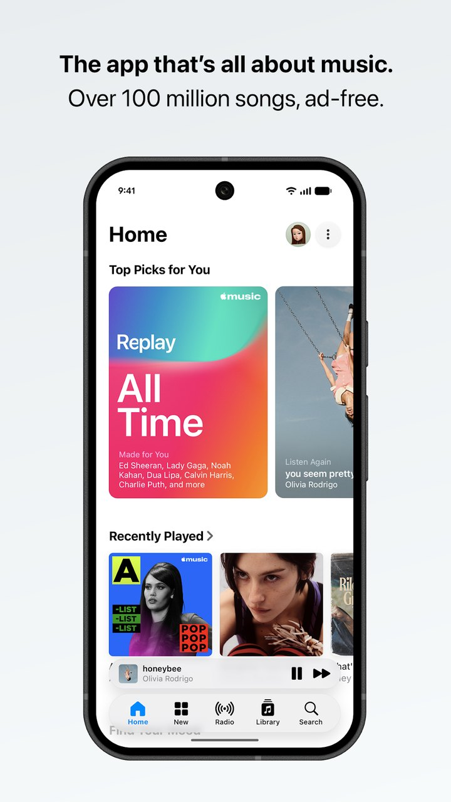
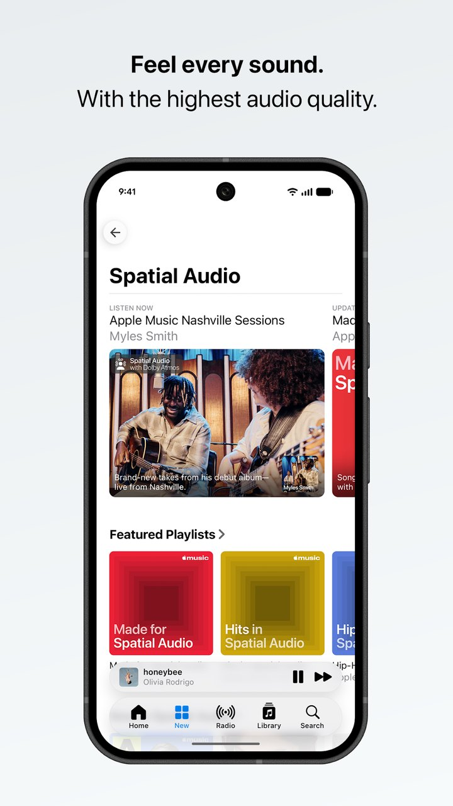
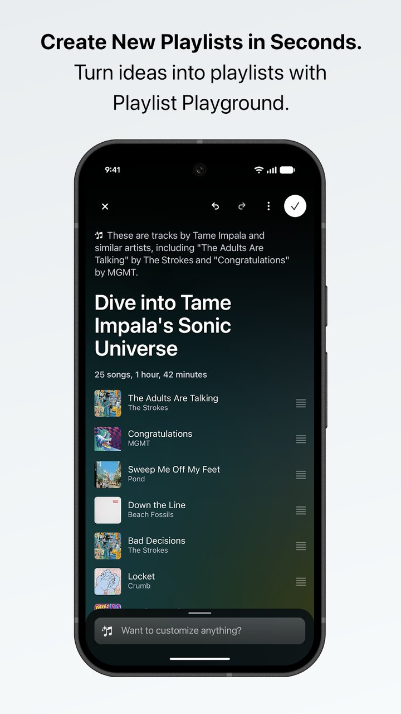

# 04 · Apple Music 7.0.0

> 与 Spotify 取向相反的样本：**浅色优先、排版驱动、留白充足**。
> 它对 Android 的做法非常"Apple"——把 iOS 的字体与尺寸体系整套搬过来，不迁就 Material。
>
> ⚠️ 本页的歌词字号与 mini player 高度已在 [09-applemusic-player.md](09-applemusic-player.md) 中按 dex 反编译结果修正
> （歌词 34sp、mini player 48dp）。播放页的背景/动效/逐字歌词细节也都在 09。

## 1. 包事实（APK）

| 项 | 值 |
| --- | --- |
| 包名 | `com.apple.android.music` |
| 版本 | 7.0.0（versionCode 1614） |
| minSdk / targetSdk | **30** / 36 |
| base APK 条目 | 4936 |
| 图标 | **1701 个 drawable XML vs 96 个位图** → 与 Spotify 同样近乎全矢量 |
| 字体 | **整套 SF Pro**：`sf_arabic` / `sf_armenian` / `sf_bangla` / `sf_devanagari` / `sf_georgian` … 且包含 **Rounded 变体**；另带 `roboto_medium_numbers.ttf`（数字专用） |
| 颜色 | 1132 条，同样**全部是动态引用** |
| 尺寸 | 1593 条，其中自有命名空间（排除 abc/m3/mtrl/cast/exo/glance）约 **677 条**，颗粒度极细 |

**两个可直接落地的信号（APK）**：

1. **minSdk 30**：它放弃 Android 11 以下设备，换来的是可以无负担使用新版 API 与 Compose 能力。
   FlareTune Client 若只服务自己，也可以把 minSdk 定在 29–31 区间，减少兼容分支。
2. **`roboto_medium_numbers.ttf` 单独打包**：Apple 连"数字字形"都要单独控制 ——
   音乐 App 里数字出现频率极高（时长、进度、曲目号、年份），这是必要投入。

## 2. 自有 token（APK，可解析为数值的部分）

### 2.1 圆角阶梯

| token | 值 |
| --- | --- |
| `corner_radius_xs` | 3 |
| `corner_radius_s` | 5 |
| `corner_radius_m` | 7 |
| `corner_radius_l` | 10 |
| `corner_radius_xl` | **14** |
| `corner_radius_xxl` | 24 |
| `corner_radius_pill` | 80 |
| `player_sheet_corner_radius` | **16** |
| `lyrics_ripple_corner_radius` | 16 |
| `foryou_mixes_corner_radius` | 6 |
| `radio_live_tile_corner_radius` | 20 |

对比 Spotify（2/4/6/8/16/999）：Apple 的圆角**整体大 2–6dp**，且有一档 14 专门给卡片。
这直接造成"Apple 更软、Spotify 更利"的观感差异。

### 2.2 排版

| token | 值 | 用途 |
| --- | --- | --- |
| `drawer_navigation_main_header_textsize` | **34sp** | 页面大标题（截图里 "Home" / "Spatial Audio"） |
| `drawer_navigation_sub_header_textsize` | 17sp | 区块标题 |
| `header_page_a_title_text_size` | 32sp | 页面头标题 |
| `header_page_a_subtitle_text_size` | 20sp | 页面头副标题 |
| `bottom_navigation_view_textsize` | 11sp | tab 文字 |
| `badge_monogram_text_size` | 12sp | 徽标 |

### 2.3 导航与播放器

| token | 值 | 含义 |
| --- | --- | --- |
| `bottom_navigation_view_item_icon_size` | 30 | tab 图标（Material 默认 24） |
| `bottom_navigation_view_item_padding_top` / `_bottom` | 9 / 13 | tab 上下留白 |
| `bottom_navigation_view_padding_horizontal` | 12 | |
| `miniplayer_height` | **48** | 底部 mini player 高度（`mini_player.xml` 实际引用） |
| `compact_player_height` | 88 | compact player 形态，手机布局里未找到引用点 |
| `mini_player_thumbnail_height` | 40 | mini player 封面 |
| `mini_player_button_size` | 48 | |
| `mini_player_max_width` | 690 | 平板/大屏上限 |
| `mini_player_horizontal_margin` | 90 | 宽屏时的悬浮边距 |
| `seekbar_corner_radius` / `minimal_seekbar_corner_radius` | 1.5 / 3.5 | 进度条圆角（≈2–4dp 高） |
| `artwork_container_size` | 540 | 详情页封面容器 |
| `artist_image_gradient_height` | 150 | 艺人页头图渐变高度 |

**mini player 实测 48dp**：`mini_player.xml` 引用 `miniplayer_height`，内容为 30dp 封面 +
两行文字（15/13）+ 32dp 播放/下一首按钮。`compact_player_height = 88dp` 是另一个资源，
在手机竖屏布局里没找到引用点（宽屏 `music_player.xml` 走完全不同的结构）。

### 2.4 歌词排版（Apple 最强的一屏）

| token | 值 |
| --- | --- |
| `lyrics_line_text_size` | **34sp**（原记 24sp，已修正） |
| `lyrics_line_static_line_height` | **26sp** |
| `lyrics_line_between_line_spacing` | **32** |
| `lyrics_static_between_line_spacing` | **40** |
| `lyrics_static_top_margin` | 30 |
| `lyrics_line_margin_horiz` | 20 |
| `lyrics_line_padding_horiz` | 32 |
| `lyrics_line_secondary_text_size` | 22sp（背景人声/次级行；17sp 是翻译菜单项） |
| `lyrics_line_writers_credits_text_size` | 22sp |
| `lyrics_bg_lyrics_margin_top` | 22 |
| `lyrics_karaoke_gradient_feather_width` | 30（逐字高亮的柔化宽度） |
| `lyrics_instrumental_dot_size` | 10 |

**读法**：歌词正文 **34sp**、静态歌词行高 26sp，但**行间距给到 32–40dp**。
这是 Apple 的典型手法：**用"块间距"而不是"行高"来拉开节奏**，每句歌词是一个独立块。
逐字高亮有 30dp 的羽化宽度，所以过渡是"扫过"而不是"跳变"。

## 3. 逐屏观察（截图）

### 3.1 首页（浅色）

- 纯白底，`Home` 大标题约 34sp 加粗，右上角头像 + 更多。
- 区块标题 `Top Picks for You` 约 22sp，紧贴内容，区块之间留白约 24–32dp。
- 卡片：**1.6:1 大卡**，圆角约 14dp，卡内文字直接压在图上（渐变卡 + 白色粗体字）。
  横向滚动，右侧露出下一张的一小条 —— **裁切即提示**。
- `Recently Played` 区块下方是方形封面（圆角约 6–8dp）。
- **mini player 悬浮在 tab bar 之上**：半透明材质 + 圆角，内含 40dp 封面、歌名/艺人、暂停/下一首。
- tab bar：5 项（Home / New / Radio / Library / Search），图标 30dp、文字 11sp，选中为蓝色。

### 3.2 页面头（浅色，带返回）

- 左上圆形返回按钮（浅灰底 + 深色箭头，约 36–40dp）。
- `Spatial Audio` 34sp 大标题；下方是横向滚动的编辑卡片：
  小号全大写 kicker（`LISTEN NOW`，约 11sp，字距拉开）+ 标题 + 艺人 + 大图（圆角 14）。
- 卡片内文字压在图片上，底部有渐变遮罩；右侧卡片被裁切。
- 再下方 `Featured Playlists` 是**纯渐变卡**（红/黄/蓝），无图片，只有色块 + 白色粗体标题 ——
  用色块替代封面，成本低但视觉统一。

### 3.3 深色场景（Playlist Playground）

- 深色底 + 从封面延伸的**对角渐变**（左绿右黑），不是模糊图。
- 顶部工具行：关闭 / 撤销 / 重做 / 更多 / 圆形确认（白底黑勾，约 32dp）。
- 说明文字 13–15sp 灰，主标题 **28–30sp 加粗三行**，元信息 `25 songs, 1 hour, 42 minutes` 13sp。
- 曲目行：48dp 封面（圆角 6）+ 标题 16sp + 艺人 13sp 灰 + 右侧拖拽手柄（三横线）。
- 底部浮动输入条：胶囊 + 模糊材质 + 占位文案，**独立于 tab bar**。

## 4. 设计语言提炼

| 维度 | 做法 | 评价 |
| --- | --- | --- |
| 明暗 | **浅色为默认**，深色用于"沉浸场景"（播放器/编辑页） | 与 Spotify 完全相反；浅色让封面成为唯一亮色，更像"唱片店" |
| 色彩 | 无品牌强调色（选中态用系统蓝）；颜色来自封面与渐变卡 | 极简，靠内容上色 |
| 字体 | SF Pro 全套（含 Rounded）+ 数字专用字体 | 排版秩序的来源，Android 上罕见的"非 Roboto"选择 |
| 字号 | 34 / 32 / 20 / 17 / 13 / 11 | 标题大、正文小、层级跨度大 |
| 圆角 | 3/5/7/10/14/24/80 | 整体偏软 |
| 间距 | 区块间 24–32，卡片内 12–16 | 留白是主要的分层手段 |
| 图标 | 1701 个矢量，线性、圆头、统一 30dp tab 图标 | 一致 |
| 层级手段 | 留白 + 字重 + 图片渐变遮罩 | 浅色界面里阴影很轻，几乎不用 |
| 播放器 | 48dp 浮动 mini player，独立于 tab bar | 与 tab bar 分离，视觉上"漂浮" |

## 5. 可以借鉴 / 应当避开

**借鉴**

1. **歌词排版四件套**：正文 **34sp** / 行高 26sp / 块间距 32dp / 翻译 22sp。中文歌词建议
   正文 20–22sp、行高 1.35、块间距 28–32dp（汉字需要更多行内呼吸）。
2. **"块间距 > 行高"的节奏法**：让每句歌词独立成块，比单纯加大行高更有呼吸感。
3. **浮动 mini player 与 tab bar 分离**：把它当"信息层"而不是"提示条"。
4. **渐变卡替代封面**：没有封面时用双色渐变 + 白色粗体标题，视觉统一且省资源。
5. **浅色优先**：如果 FlareTune 的使用场景是"白天随手听"，浅色比深色更亲和，
   且能让封面成为画面唯一的高饱和区域。
6. **裁切即提示**：横向滚动列表让下一张露出 8–12%，不需要箭头或圆点。

**避开**

1. **34sp 中文大标题**：汉字在 34sp 下占位大、折行难看，中文建议 28–30sp 上限。
2. **1.08 的行高**：拉丁字母可以贴，汉字会挤成一坨，中文行高不低于 1.3。
3. **把 iOS 交互直接搬过来**（右滑返回、长按菜单形态）：Android 用户不认，
   这也是 Apple Music Android 版被诟病最多的地方。
4. **无强调色**：Apple 有系统级品牌认知兜底，FlareTune 没有，需要至少一个可识别的强调色。

## 6. 未知

- 播放器全屏页的具体构图（商店截图未包含 now playing，本次未取得）。
- 浅色/深色的切换策略（跟随系统还是手动）。
- 动效：`res/anim` 与 `animator` 目录存在，但未解析参数；共享元素转场的时长/曲线未知。
- 中文界面下的实际字号（截图均为英文，中文字形宽度不同，实际观感会变）。
